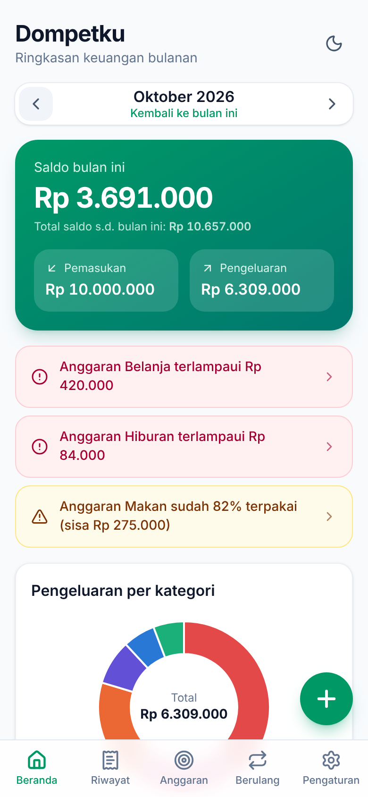
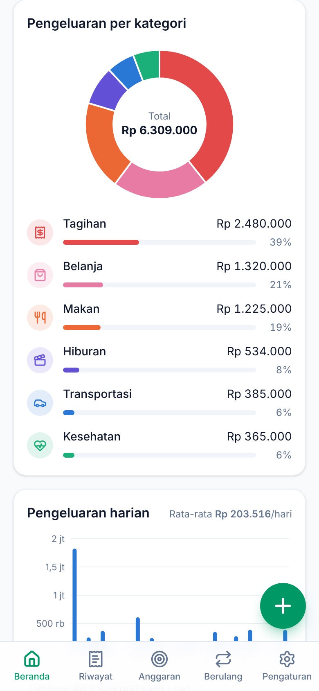
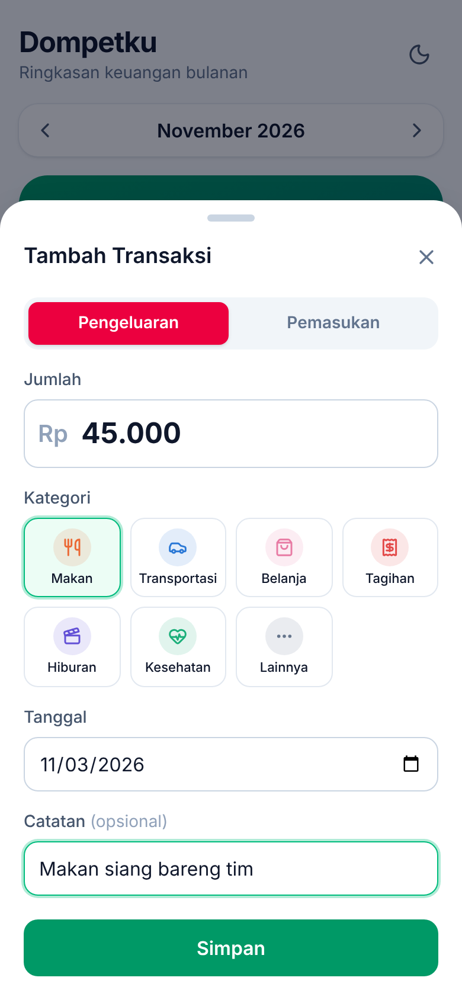
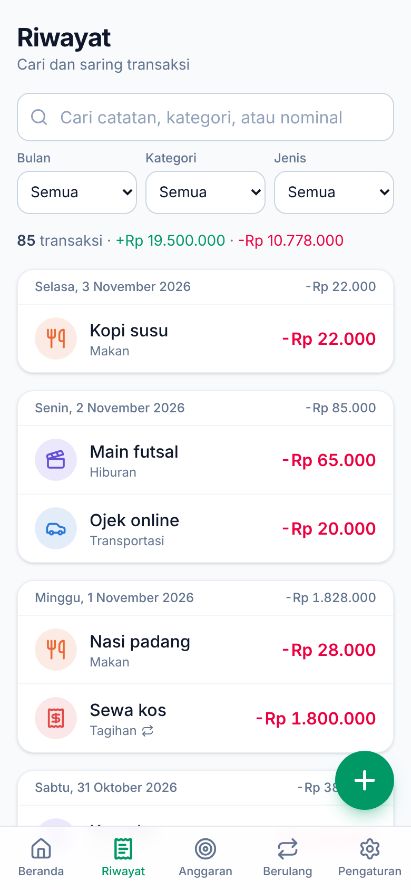
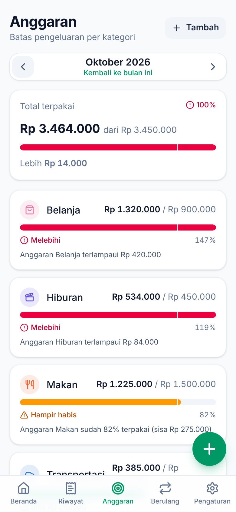
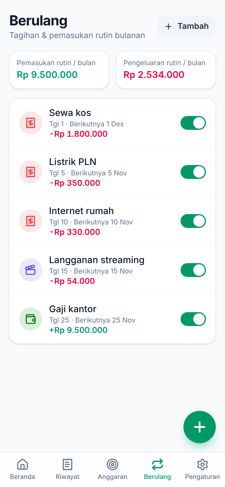
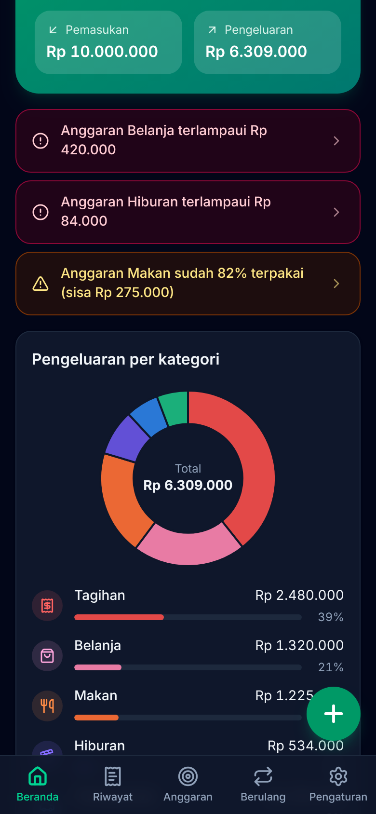

# Dompetku

**Dompetku** adalah aplikasi web pencatat keuangan pribadi untuk mencatat pemasukan & pengeluaran harian. Bisa dipasang di HP seperti aplikasi biasa (PWA), tetap bekerja **tanpa internet**, dan data tersimpan di perangkatmu sendiri (IndexedDB). Opsional: **sinkronisasi HP & laptop** lewat login email. Di-hosting gratis di GitHub Pages.

🔗 **Coba langsung:** <https://rifqihh1689-hash.github.io/dompetku/> (aktif setelah GitHub Pages dinyalakan — lihat [Deploy ke GitHub Pages](#deploy-ke-github-pages))

<table>
  <tr>
    <td align="center"><br /><sub>Beranda</sub></td>
    <td align="center"><br /><sub>Grafik bulanan</sub></td>
    <td align="center"><br /><sub>Tambah transaksi</sub></td>
    <td align="center"><br /><sub>Riwayat</sub></td>
  </tr>
  <tr>
    <td align="center"><br /><sub>Anggaran</sub></td>
    <td align="center"><br /><sub>Transaksi berulang</sub></td>
    <td align="center"><br /><sub>Mode gelap</sub></td>
    <td></td>
  </tr>
</table>

## Fitur

- **Catat transaksi** — tambah, ubah, dan hapus (dengan tombol _Urungkan_) pemasukan/pengeluaran: jumlah, jenis, kategori, tanggal, dan catatan. Nominal otomatis diformat saat diketik (`1.250.000`).
- **Kategori** — kategori bawaan (Makan, Transportasi, Belanja, Tagihan, Hiburan, Kesehatan, Gaji, Lainnya) dan kategori buatan sendiri dengan pilihan ikon & warna. Kategori yang dihapus memindahkan transaksinya ke "Lainnya".
- **Dashboard bulanan** — saldo bulan ini, total pemasukan & pengeluaran, saldo kumulatif, grafik donat pengeluaran per kategori, dan grafik batang tren pengeluaran harian (rata-rata & hari tertinggi).
- **Anggaran (budget)** — batas pengeluaran per kategori per bulan dengan progress bar. Peringatan muncul saat pemakaian **≥ 80%** (hampir habis) dan **> 100%** (terlampaui) — di Beranda dan langsung setelah menyimpan pengeluaran. Anggaran bisa disalin dari bulan sebelumnya.
- **Riwayat** — dikelompokkan per tanggal dengan subtotal harian; pencarian (catatan, kategori, nominal) dan filter bulan, kategori, jenis.
- **Transaksi berulang** — tagihan/gaji bulanan dicatat otomatis setiap bulan pada tanggalnya (tanggal 29–31 disesuaikan dengan akhir bulan), termasuk mengejar bulan yang terlewat saat aplikasi tidak dibuka. Dijamin tidak dobel. Bisa dijeda, diberi bulan berakhir, diubah, atau dihapus.
- **Backup & restore** — export/import JSON (pilih _Gabungkan_ atau _Ganti semua_, dengan validasi file), dan export **CSV** untuk Excel (UTF-8, pemisah `;` untuk Excel Indonesia atau `,`).
- **Mode gelap/terang** — Terang, Gelap, atau Ikuti sistem; tombol cepat di Beranda.
- **Format Rupiah & Bahasa Indonesia** — `Rp 1.250.000`, nama hari/bulan Indonesia, seluruh antarmuka berbahasa Indonesia.
- **Mobile-first & satu tangan** — navigasi bawah, tombol tambah transaksi mengambang (FAB) di kanan bawah, form dalam _bottom sheet_.
- **PWA & offline** — bisa dipasang di layar utama HP, seluruh aset di-cache sehingga tetap jalan tanpa internet, dan ada notifikasi saat versi baru tersedia.
- **Sinkronisasi HP & laptop (opsional)** — masuk dengan email (kode OTP, tanpa kata sandi) dan data tersambung otomatis di semua perangkat; tetap bisa dipakai offline. Tanpa login, data hanya di perangkat itu. Lihat [Sinkronisasi HP & laptop](#sinkronisasi-hp--laptop).

## Teknologi

| Bagian        | Pustaka                                                                                                                                             |
| ------------- | --------------------------------------------------------------------------------------------------------------------------------------------------- |
| UI            | [React](https://react.dev) + [TypeScript](https://www.typescriptlang.org), dibangun dengan [Vite](https://vite.dev)                                 |
| Tampilan      | [Tailwind CSS](https://tailwindcss.com), ikon [Lucide](https://lucide.dev)                                                                          |
| Penyimpanan   | IndexedDB lewat [Dexie](https://dexie.org) (`useLiveQuery` untuk UI reaktif)                                                                        |
| Sinkronisasi  | [Dexie Cloud](https://dexie.org/cloud/) (opsional, dimuat hanya bila dikonfigurasi)                                                                 |
| Grafik        | [Recharts](https://recharts.org) (dimuat _lazy_ agar halaman awal ringan)                                                                           |
| PWA           | [vite-plugin-pwa](https://vite-pwa-org.netlify.app) (Workbox)                                                                                       |
| Tes           | [Vitest](https://vitest.dev) + [React Testing Library](https://testing-library.com) + [fake-indexeddb](https://github.com/dumbmatter/fakeIndexedDB) |
| Kualitas kode | oxlint, Prettier                                                                                                                                    |

## Menjalankan di komputer

Prasyarat: **Node.js 22.22+** (atau 24.15+) dan npm.

```bash
git clone https://github.com/rifqihh1689-hash/dompetku.git
```

```bash
cd dompetku
```

```bash
npm ci
```

```bash
npm run dev
```

Buka <http://localhost:5173/dompetku/> di browser. Untuk mencoba tampilan HP, gunakan mode perangkat di DevTools (F12 → ikon ponsel).

### Perintah npm

| Perintah                          | Kegunaan                                                                                       |
| --------------------------------- | ---------------------------------------------------------------------------------------------- |
| `npm run dev`                     | Server pengembangan dengan hot reload                                                          |
| `npm run build`                   | Cek tipe TypeScript lalu build produksi ke `dist/`                                             |
| `npm run preview`                 | Menjalankan hasil build (termasuk service worker/offline) di <http://localhost:4173/dompetku/> |
| `npm test`                        | Menjalankan semua tes sekali                                                                   |
| `npm run test:watch`              | Tes dalam mode pantau                                                                          |
| `npm run test:coverage`           | Tes dengan laporan coverage                                                                    |
| `npm run lint`                    | Lint dengan oxlint                                                                             |
| `npm run format` / `format:check` | Merapikan / mengecek format kode dengan Prettier                                               |

> Mode offline (service worker) hanya aktif pada hasil build — gunakan `npm run build` lalu `npm run preview` untuk mengujinya.

## Struktur proyek

```
src/
├── app/router.ts            # router berbasis hash (#/riwayat, #/anggaran, …)
├── components/              # komponen UI umum: Modal, Toast, FAB, navigasi bawah, input nominal, …
├── db/                      # database Dexie, hook useLiveQuery, penyimpanan persisten
├── features/
│   ├── transactions/        # form, daftar & riwayat transaksi, filter/pencarian
│   ├── categories/          # kategori bawaan, ikon & warna, kelola kategori
│   ├── dashboard/           # ringkasan saldo, grafik per kategori & tren harian
│   ├── budget/              # anggaran, status 80%/100%, peringatan
│   ├── recurring/           # aturan transaksi berulang & pembuatan otomatis
│   ├── backup/              # export/import JSON, export CSV
│   ├── settings/            # halaman pengaturan & tema gelap/terang
│   ├── sync/                # login email & status sinkronisasi (Dexie Cloud)
│   └── pwa/                 # pembaruan service worker & tombol pasang aplikasi
├── lib/                     # utilitas format Rupiah, tanggal Indonesia, unduh file
└── types.ts                 # tipe data utama
```

Logika penting (saldo, anggaran, transaksi berulang, backup/CSV, filter) ditulis sebagai fungsi murni terpisah dari komponen sehingga mudah dites. Tes berada di samping kodenya (`*.test.ts(x)`).

## Deploy ke GitHub Pages

Repo ini sudah berisi workflow [`.github/workflows/deploy.yml`](.github/workflows/deploy.yml) yang otomatis menjalankan cek format, lint, tes, build, lalu deploy **setiap ada push ke branch `main`**. Pull request ke `main` hanya dicek tanpa deploy.

Langkah sekali saja untuk mengaktifkannya:

1. Buka repo di GitHub → **Settings** → **Pages**.
2. Pada **Build and deployment** → **Source**, pilih **GitHub Actions**.
3. Push (atau merge pull request) ke branch `main`. Pantau prosesnya di tab **Actions**.
4. Setelah selesai, aplikasi tersedia di `https://<username>.github.io/<nama-repo>/` — untuk repo ini: <https://rifqihh1689-hash.github.io/dompetku/>.

Catatan:

- `base` Vite diatur ke `/dompetku/` di [`vite.config.ts`](vite.config.ts). Di GitHub Actions nilainya otomatis mengikuti nama repo lewat variabel `BASE_PATH`, jadi jika repo diganti nama, tidak perlu mengubah apa pun.
- Untuk domain kustom (aplikasi di akar domain), build dengan `BASE_PATH=/`.
- Workflow juga bisa dijalankan manual dari tab **Actions** → _Build & Deploy ke GitHub Pages_ → **Run workflow** (deploy hanya dari branch `main`).

## Memasang di HP

Buka alamat aplikasi di browser HP, lalu:

**Android (Chrome / Edge / Samsung Internet)**

1. Buka **Pengaturan** di Dompetku → bagian **Pasang di HP** → ketuk **Pasang aplikasi**, _atau_
2. Ketuk menu **⋮** browser → **Instal aplikasi** / **Tambahkan ke layar utama**.

**iPhone / iPad (Safari)**

1. Ketuk tombol **Bagikan** (kotak dengan panah ke atas).
2. Pilih **Tambah ke Layar Utama** → **Tambah**.

Setelah terpasang, Dompetku terbuka layar penuh seperti aplikasi biasa dan bisa dipakai tanpa internet. Saat ada versi baru, akan muncul notifikasi **Perbarui**.

## Sinkronisasi HP & laptop

Sinkronisasi memakai [Dexie Cloud](https://dexie.org/cloud/). Bersifat **opsional**: tanpa login, Dompetku bekerja sepenuhnya lokal seperti biasa.

### Cara memakai (setiap pengguna)

1. Buka Dompetku → **Pengaturan** → bagian **Sinkronisasi HP & laptop** → **Masuk / Daftar dengan email**.
2. Masukkan email → **Kirim kode** → buka email, salin kodenya → **Masuk**.
3. Lakukan hal yang sama di perangkat lain dengan **email yang sama**. Data akan tersambung otomatis.

Catatan:

- Data yang sudah ada di perangkat ikut terunggah saat pertama kali masuk.
- Tetap bisa dipakai offline; perubahan dikirim otomatis saat online. Ikon awan di Beranda menunjukkan status sinkronisasi.
- **Keluar** menghapus data dari perangkat itu saja; data tetap aman di cloud dan kembali saat masuk lagi.
- Setiap email punya data sendiri. Pengguna lain tidak bisa melihat datamu.

### Menyiapkan server sinkronisasi (sekali, oleh pemilik repo)

Butuh Node.js di komputer. Jalankan di folder kosong (di luar folder proyek):

1. Buat database Dexie Cloud (masukkan email pemilik lalu kode yang dikirim ke email):

   ```bash
   npx dexie-cloud create
   ```

   Perintah ini membuat `dexie-cloud.json` (berisi alamat database, mis. `https://zxxxxxxx.dexie.cloud`) dan `dexie-cloud.key` (**rahasia — jangan dibagikan atau di-commit**).

2. Izinkan alamat aplikasi mengakses database:

   ```bash
   npx dexie-cloud whitelist https://rifqihh1689-hash.github.io
   ```

   ```bash
   npx dexie-cloud whitelist http://localhost:5173
   ```

3. Salin `.env.example` menjadi `.env` di proyek ini, isi `VITE_DEXIE_CLOUD_URL` dengan alamat database dari langkah 1, lalu commit & push ke `main`. Alamat ini bukan rahasia.
4. **Jadikan akun permanen.** Pengguna baru berstatus _uji coba_ (30 hari aktif); setelah itu sinkronisasi berhenti. Paket gratis Dexie Cloud menyediakan **3 akun permanen (production)** — atur di aplikasi manajemen Dexie Cloud (Dexie Cloud Manager). Lihat [harga Dexie Cloud](https://dexie.org/cloud/pricing).

> Jangan mengganti alamat database setelah dipakai: data di cloud lama tidak ikut pindah.

## Data & privasi

- Tanpa login, semua data hanya disimpan di **browser/perangkat ini** (IndexedDB). Tidak ada akun atau pelacakan.
- Bila masuk untuk sinkronisasi, salinan data disimpan di server **Dexie Cloud** dan hanya bisa diakses dengan email tersebut.
- Tanpa sinkronisasi, untuk pindah HP: **Pengaturan → Export JSON** di perangkat lama, lalu **Import JSON** di perangkat baru.
- Menghapus data situs/browser juga menghapus data lokal Dompetku. Aplikasi meminta penyimpanan persisten, namun tetap **buat backup secara berkala**. Di iPhone, pasang ke Layar Utama agar data tidak dibersihkan otomatis oleh Safari.
- **Hapus semua data** dan **Import → Ganti semua** saat sedang masuk juga berlaku untuk data di cloud (semua perangkat).

### Format file

- **Backup JSON** — `{ "app": "dompetku", "version": 2, "exportedAt": "…", "data": { "categories": [], "transactions": [], "budgets": [], "recurring": [] } }`. Nominal disimpan sebagai bilangan bulat Rupiah, tanggal sebagai `YYYY-MM-DD`. `categories` hanya berisi kategori buatan sendiri dan perubahan atas kategori bawaan. Backup versi 1 tetap bisa diimpor.
- **CSV** — kolom `Tanggal;Jenis;Kategori;Jumlah;Catatan`, UTF-8 dengan BOM agar huruf terbaca benar di Excel. Kolom _Jumlah_ berupa angka polos sehingga bisa langsung dijumlahkan.
